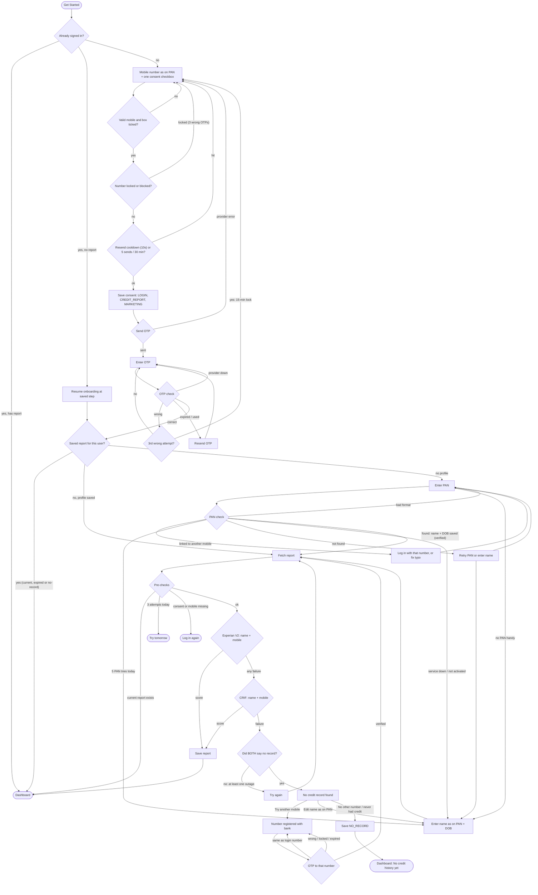

# Relive: login and onboarding flow

This document describes how login and onboarding behave in the code today. All steps happen inside the login dialog on the landing page. The user only reaches `/portal` once they have a report (or a confirmed "no credit history").

## Flowchart



## Every branch, step by step

### 1. Entry

| Situation | Result |
|---|---|
| Already signed in, has a report | Straight to the dashboard |
| Already signed in, onboarding unfinished | Dialog opens at the step they left |
| Opens `/portal` with onboarding unfinished | Redirected to `/?onboarding=1`, dialog opens at that step |
| Session expired / not signed in | Mobile step |

### 2. Mobile and consent (`POST /auth/request-otp`)

| Check | Code | User sees / can do |
|---|---|---|
| Not 10 digits starting 6–9 | client + `VALIDATION_ERROR` | "Enter a valid 10-digit mobile number" |
| Consent box not ticked | client + `VALIDATION_ERROR` | "Consent is required to proceed" |
| Account blocked by admin | `ACCOUNT_BLOCKED` 403 | Contact support |
| Locked after 3 wrong OTPs | `OTP_ATTEMPTS_EXCEEDED` 429 | Wait 15 minutes |
| Asked again within 10 s | `RESEND_TOO_SOON` 429 | Countdown restarts |
| 5 OTPs in 30 min | `OTP_SEND_LIMIT` 429 | Wait 30 minutes |
| Too many requests from one IP (20 / 10 min) | 429 | Wait |
| OTP provider rejects number | `OTP_SEND_FAILED` 422 | Check the number |
| OTP provider down / slow | 503 / 504 | Try again (never auto-retried: no double SMS) |
| OK | 201 | New user created if unknown; consent saved per purpose (LOGIN, CREDIT_REPORT, MARKETING) with version, IP and browser; OTP step |

### 3. OTP (`POST /auth/verify-otp`)

| Check | Code | User sees / can do |
|---|---|---|
| Wrong OTP (1st/2nd) | `INVALID_OTP` 400 | "Invalid OTP. N attempts left" |
| Wrong OTP (3rd, counted across resends) | `OTP_ATTEMPTS_EXCEEDED` 429 | Back to mobile step, locked 15 min |
| OTP older than 5 min | `OTP_EXPIRED` 410 | Resend enabled |
| Superseded by a resend / already used | `OTP_EXPIRED` / `OTP_ALREADY_USED` | Resend enabled |
| Provider down while verifying | 503 / 504 | Try again; **not** counted as a wrong attempt |
| Correct | 200 + session cookie (8 h) | Routed by the table below |

| After OTP | Goes to |
|---|---|
| Any saved report (current, expired, or "no credit history") | Dashboard |
| Profile saved, no report | Fetch report step |
| No profile | PAN step |

### 4. PAN (`POST /kyc/verify`)

| Check | Code | User sees / can do |
|---|---|---|
| Wrong format (not ABCDE1234F) | client + `VALIDATION_ERROR` | Fix and retry |
| PAN verified on another account | `PAN_ALREADY_LINKED` 409 | Retry (typo) or log in with the other number |
| 5 PAN tries in 24 h (billed) | `PAN_ATTEMPT_LIMIT` 429 | Enter name as on PAN |
| PAN not found | `PAN_NOT_VERIFIED` 422 | Retry PAN or enter name as on PAN |
| PAN API not activated (mock PAN with live bureaus) | `PAN_UNAVAILABLE` 422 | Enter name as on PAN |
| PAN API down / bad response | 503 / 504 | Retry or enter name |
| Found | 200 | Full name (incl. middle) + DOB saved as verified → report fetched immediately |
| User clicks "Enter your name as on PAN" | — | Name form |

### 5. Name as on PAN (`POST /profile/manual`)

First name and DOB required; middle/last name and email optional. Saved as unverified, then the report is fetched immediately. Validation errors keep the user on the form.

### 6. Credit report (`POST /credit/report`)

Bureaus match on **name + mobile**. The mobile used is the OTP-verified alternate number if there is one, otherwise the login number.

| Check (in order) | Code | User sees / can do |
|---|---|---|
| Current report (< 30 days) exists | 200 | Reused, no new billed pull → dashboard |
| No profile | `PROFILE_REQUIRED` 409 | Back to PAN step |
| No bureau consent (old account) | `CONSENT_REQUIRED` 409 | Log in again (re-consents) |
| 3 attempts in 24 h | `REPORT_ATTEMPT_LIMIT` 429 | Try tomorrow |
| Stored mobile unreadable | `MOBILE_REVERIFY_REQUIRED` 409 | Log in again |
| Already fetching | `REPORT_IN_PROGRESS` 409 | Wait / try again |
| Experian returns a score (300–900) | 200 | Saved → dashboard |
| Experian fails for **any** reason | — | CRIF is called |
| CRIF returns a score | 200 | Saved → dashboard |
| Both said "no record" | `NO_CREDIT_RECORD` 422 | Try another mobile / edit name / "no other number" |
| Anything else (any outage or timeout) | `REPORT_UNAVAILABLE` 503 | Try again (we can't conclude "no record") |

"No record" means `ok: false`, no score, or a score outside 300–900. Bureau calls are never retried automatically (each is billed).

### 7. No record: alternate mobile (`/credit/bureau-mobile/request-otp` → `/verify`)

| Check | Code | User sees / can do |
|---|---|---|
| Same as the login number | `SAME_MOBILE` 400 | Enter a different number |
| Cooldown / send limits / lockout | same as step 2 | Same handling (limits are shared with login) |
| Wrong / expired OTP | same as step 3 | Same handling; lockout returns to the number step |
| Verified | 200 | Number saved (encrypted) as the bureau number → report fetched again |

### 8. No record: no other number (`POST /credit/no-history`)

| Check | Code | Result |
|---|---|---|
| Last Experian **and** CRIF attempts (within 24 h) were not both "no record" | `NO_RECORD_UNCONFIRMED` 409 | Must fetch first (an outage is not "no history") |
| OK | 200 | `NO_RECORD` saved → dashboard shows "No credit history yet" with tips and "Check the bureaus again" |

## Limits at a glance

| Limit | Value |
|---|---|
| OTP validity | 5 min |
| Resend cooldown | 10 s |
| OTP sends | 5 per 30 min per user (login + alternate number combined) |
| Wrong OTPs | 3 per user, across resends and numbers → 15-min lock |
| PAN lookups | 5 per 24 h per user |
| Report attempts | 3 per 24 h per user (each = up to 2 billed pulls) |
| Report reuse | 30 days |
| Session | 8 h |
| Per-IP | 20 auth requests and 30 sensitive requests per 10 min |

## Audit trail (audit database)

Nothing about onboarding is kept in the browser: it holds only the httpOnly session cookie and the theme setting. Progress lives on the server, and every step is recorded in the **audit database** (`relive_audit`). Only the last 4 digits of mobile and PAN numbers are stored there.

**`audit_logs`**: one row per event, in order:

| Event | Recorded when |
|---|---|
| `CONSENT_GRANTED` | Checkbox accepted (version, purposes, IP, browser) |
| `OTP_SENT` / `OTP_SEND_FAILED` | Login or alternate-number OTP sent / provider failed |
| `OTP_INVALID` / `OTP_LOCKED` | Wrong OTP / 3rd wrong OTP |
| `LOGIN` | OTP verified (new vs existing user, where they land) |
| `PAN_VERIFIED` / `PAN_FAILED` | PAN lookup result (with reason) |
| `DETAILS_SAVED` | Name as on PAN entered |
| `BUREAU_FAILED` | Experian or CRIF failed (which bureau, why, which mobile) |
| `REPORT_FETCHED` | Score saved (bureau, score, whether CRIF fallback was used) |
| `REPORT_NO_RECORD` / `REPORT_UNAVAILABLE` | Both bureaus had no record / an outage |
| `ALT_MOBILE_VERIFIED` | Alternate number verified |
| `NO_CREDIT_HISTORY_CONFIRMED` | User confirmed they're new to credit |
| `LOGOUT` | User logged out |
| `API_ERROR` | Any rejected request (error code + endpoint) |

**`onboarding_journeys`**: one row per user with `status` (`IN_PROGRESS`, `COMPLETED`, `NO_CREDIT_HISTORY`), `current_step`, last event and outcome, identity source (PAN or manual), counters (OTP sends and failures, PAN and report attempts), and start / last activity / completion times. Unfinished onboardings are `status = 'IN_PROGRESS'`.

To view them:

```powershell
npm run journey -w backend                 # everyone with unfinished onboarding
npm run journey -w backend -- 9876543210   # one user's summary + full timeline
```

## Not covered yet

- Experian V3 (PAN-only lookup) is not activated. When it is, it can find the bureau-registered mobile for the "no record" case (then OTP that number and use V2 for the full report).
- OTP and PAN APIs run on mocks until IndiConnect activates them (`OTP_PROVIDER`, `PAN_PROVIDER` in `backend/.env`).
